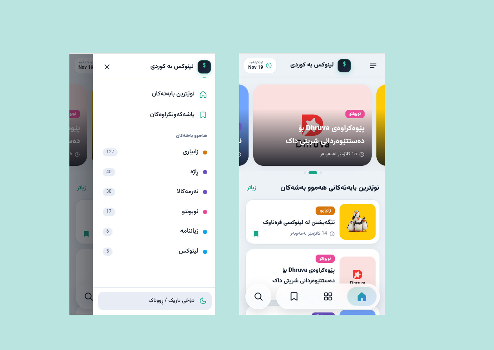

<p align="center">
  
</p>


# لینوکس بە کوردی — ئەپی PWA

ئەپێکی وێب (PWA) بۆ ماڵپەڕی **[linux.krd](https://linux.krd)** کە بابەتەکانی ماڵپەڕ بە شێوەیەکی جوان نیشان دەدات. لەسەر ئایفۆن و ئەندرۆید وەک ئەپ دادەمەزرێت و بێ ئینتەرنێتیش بابەتە کراوەکان دەخوێنرێنەوە.

> بابەتەکان لە **REST API ـی وردپرێس** (`/wp-json/wp/v2`) دەخوێنرێنەوە، بۆیە پێویست بە داتابەیس یان سێرڤەری جیا نییە — تەنها چەند فایلی ستاتیک.

---



## تایبەتمەندییەکان

- 🎠 **ئەسلایدەری سەرەوە** — سێ بابەتی تایبەت (سەرەتا بابەتە سنجاقکراوەکان، دواتر نوێترینەکان) و خۆکار دەسوڕێتەوە
- 🆕 **نوێترین بابەتەکانی هەموو بەشەکان** بە لیستێکی جوان و دوگمەی «زیاتر»
- ☰ **مێنیوی هەمبەرگەری** (لای ڕاست) بۆ هەموو بەشەکان لەگەڵ ژمارەی بابەتەکان
- 🕒 **بەرواری دوایین نوێکردنەوە** لە سەرەوەی چەپ
- 📄 **پەنجەرەی خوارەوە** (Bottom Sheet) — کلیک لەسەر بابەت یان بەش، لە خوارەوە دەکرێتەوە؛ بە ڕاکێشان یان دوگمەی گەڕانەوە دادەخرێت
- 🔖 پاشەکەوتکردنی بابەت (بێ ئینتەرنێتیش دەکرێتەوە)، هاوبەشکردن، گەورە/بچووککردنی نووسین، کۆپیکردنی کۆد
- 🔍 گەڕان لە بابەتەکان
- 🌗 دۆخی تاریک و ڕووناک
- 🫧 مێنیوی خوارەوەی شووشەیی (Liquid Glass)
- 📴 کارکردن بێ ئینتەرنێت بە Service Worker
- ⬇️ دوگمەی دامەزراندن (Install)

---

## پێکهاتەی فایلەکان

```
linux-krd-pwa/
├── index.html              # پەڕەی سەرەکی
├── style.css               # دیزاین
├── app.js                  # لۆژیکی ئەپ + ڕێکخستنەکان (CONFIG)
├── sw.js                   # Service Worker (کاشکردن و ئۆفڵاین)
├── manifest.webmanifest    # زانیاری PWA (ناو، ڕەنگ، ئایکۆن)
└── icons/                  # ئایکۆنەکان
```

---

## ڕێکخستن

سەرەتا فایلی `app.js` بکەرەوە؛ لە سەرەوەی فایلەکە بەشی `CONFIG` هەیە:

```js
const CONFIG = {
  site: "https://linux.krd", // ناونیشانی ماڵپەڕ (بێ / لە کۆتاییدا)
  perPage: 10,               // ژمارەی بابەت لە هەر جارێکدا
  wordsPerMinute: 180,       // بۆ هەژمارکردنی کاتی خوێندنەوە
  sliderCount: 3,            // ژمارەی بابەتەکانی ئەسلایدەر
  sliderCategory: 0,         // ID ی بەشێک بۆ ئەسلایدەر (٠ = سنجاقکراو + نوێترین)
};
```

**چۆن ID ی بەش بدۆزمەوە؟** لە ماڵپەڕ بچۆ بۆ `https://linux.krd/wp-json/wp/v2/categories` — لەوێ `id` ی هەر بەشێک دەبینیت. ئەگەر بەشێکی «پڕۆژەکان» هەبێت، ژمارەکەی لە `sliderCategory` بنووسە.

---

## تاقیکردنەوە لەسەر کۆمپیوتەر

PWA پێویستی بە سێرڤەر هەیە (بە کردنەوەی ڕاستەوخۆی `index.html` ناکار ناکات).

```bash
cd linux-krd-pwa
python3 -m http.server 8000
```

پاشان لە وێبگەڕ بکەرەوە: `http://localhost:8000`


## دامەزراندن لەسەر مۆبایل

**ئایفۆن (Safari):**
١. ناونیشانی ئەپ لە **Safari** بکەرەوە
٢. دوگمەی **Share** (چوارگۆشەی تیردار) دابگرە
٣. **Add to Home Screen** هەڵبژێرە ← **Add**

**ئەندرۆید (Chrome):**
١. ناونیشانی ئەپ لە **Chrome** بکەرەوە
٢. مێنیوی ☰ ی ئەپ بکەرەوە و **دامەزراندنی ئەپ** دابگرە، یان لە مێنیوی Chrome ـەوە **Install app**

---

## خوێندنەوەی داتا و CORS

ئەپ بە `fetch` داتا لە `https://linux.krd/wp-json/` وەردەگرێت. وردپرێس بە شێوەی بنەڕەتی CORS ڕێگە دەدات، بەڵام ئەگەر ئەپ لە دۆمەینێکی دیکە بوو (وەک GitHub Pages) و داتا بار نەبوو:

- دڵنیابە REST API کار دەکات: `https://linux.krd/wp-json/wp/v2/posts`
- بپشکنە کە پلەگینێکی ئاسایش (وەک Wordfence یان «Disable REST API») REST API نەبەستووە
- ئەگەر ماڵپەڕ تەنها `http` ـە، HTTPS چالاک بکە، چونکە ئەپی HTTPS ناتوانێت داواکاری `http` بکات

---

## گۆڕینی دیزاین

- **ڕەنگەکان:** لە سەرەتای `style.css` گۆڕاوەکانی `:root` (`--accent`، `--accent-2`، `--bg` …)
- **ناوی ئەپ:** لە `manifest.webmanifest` (`name` و `short_name`) و تاگی `<title>` ی `index.html`
- **ئایکۆن:** ئایکۆنەکانی `icons/` بگۆڕە (١٩٢ و ٥١٢ پیکسڵ، `maskable` و `apple-touch-icon` ١٨٠ پیکسڵ)
- **فۆنت:** Vazirmatn لە Google Fonts بار دەبێت؛ بۆ بەکارهێنانی ئۆفڵاینی تەواو، فۆنتەکە دابەزێنە و بە `@font-face` ببەستەرەوە

---

## نوێکردنەوەی ئەپ

دوای هەر گۆڕانکارییەک لە فایلەکان، لە `sw.js` ژمارەی وەشان بگۆڕە تا بەکارهێنەران وەشانی نوێ وەربگرن:

```js
const VERSION = "v3"; // v2 ← v3
```

---

## چارەسەری کێشەکان

| کێشە | چارەسەر |
|------|---------|
| بابەتەکان بار نابن | ناونیشانی `CONFIG.site` و `/wp-json/wp/v2/posts` بپشکنە، CORS و HTTPS ببینە |
| دوگمەی دامەزراندن نییە | ئەپ دەبێت لەسەر HTTPS بێت و `manifest` و ئایکۆنەکان دروست بن |
| گۆڕانکارییەکان نابینرێن | وەشانی `VERSION` لە `sw.js` بگۆڕە یان داتای وێبگەڕ بسڕەوە |
| فۆنت نیشان نادات | ئینتەرنێت پێویستە بۆ یەکەم جار (Google Fonts)؛ دواتر کاش دەکرێت |
| ئایفۆن: ئەپ نەکرایەوە وەک ئەپ | لە **Safari** بەکاریبهێنە، نەک وێبگەڕێکی تر |

---

## مۆڵەت

ئەم پڕۆژەیە لەژێر مۆڵەتی **GNU General Public License v3.0 (یان وەشانی نوێتر)** بڵاو کراوەتەوە — بڕوانە فایلی [`LICENSE`](LICENSE).

بە کورتی: دەتوانیت بەکاری بهێنیت، بگۆڕیت و بڵاوی بکەیتەوە، بەڵام هەر وەشانێکی گۆڕدراو یان بڵاوکراوە دەبێت بەهەمان مۆڵەتی GPL بمێنێتەوە و سەرچاوەکەی بەردەست بێت.

Copyright (C) 2026 Linux.krd
